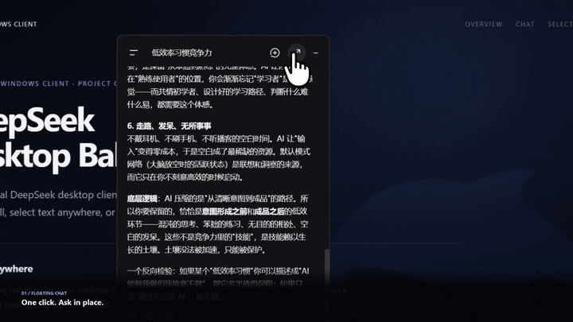

# DeepSeek Floating Ball (Unofficial)

English | [简体中文](README.zh-CN.md)

An unofficial Windows desktop floating client for DeepSeek, built with Tauri. The chat interface is based on [chat-demo](https://github.com/deepseek-ai/chat-demo); the floating ball, window management, and desktop integration are implemented by this project.

> This project is not affiliated with, endorsed by, or sponsored by DeepSeek. DeepSeek brand assets remain the property of their respective owners. See [TRADEMARKS.md](TRADEMARKS.md).

## Demo



[Watch the full 50-second demo (MP4)](https://lihaoyan25.github.io/deepseek-desktop-ball/demo-preview/deepseek-demo-final-optimized.mp4)

## Download

Download the latest installer from [Releases](https://github.com/lihaoyan25/deepseek-desktop-ball/releases/latest):

- [DeepSeekBall_0.1.0_x64-setup.exe](https://github.com/lihaoyan25/deepseek-desktop-ball/releases/latest/download/DeepSeekBall_0.1.0_x64-setup.exe)
- [SHA256SUMS.txt](https://github.com/lihaoyan25/deepseek-desktop-ball/releases/latest/download/SHA256SUMS.txt)

No Node.js, Rust, or other development environment is required. Windows 10/11 x64 with the WebView2 Runtime is required. On first launch, enter your own DeepSeek API key in Settings.

The installer is unsigned. If Windows SmartScreen appears, choose **Run anyway**.

### Controls

- `Ctrl + Shift + Space`: show or hide the panel.
- Click the floating ball: restore the last mini or maximized mode.
- Drag the floating ball: move it; near a screen edge it tucks into a tail.
- Mini mode, top-right: new chat, maximize, hide.
- Maximized mode, top-right: restore mini mode, hide. Both modes can be dragged and resized.
- Drag a window edge or corner to resize. Double-click the title bar to switch between mini and maximized. Size and position are remembered per mode.
- Settings → General → Window size → Reset size restores the default window size.
- Settings → General → Selection AI enables the global selection toolbar. Press `Ctrl + Shift + A` for screenshot Q&A.

## Features

- Floating ball with drag, edge tucking, and single-instance behavior.
- Freely resizable mini and maximized windows (minimum 320×400), with per-mode size and position remembered.
- Compact layout for small windows: the welcome text, messages, input field, and controls scale down together.
- Selection AI toolbar for explain, summarize, translate, copy, and search. Text automatically opens in a compact chat; screenshots are sent through the existing DeepSeek image attachment path.
- Markdown, syntax highlighting, KaTeX math, thinking traces, deep thinking, smart search, and source citations.
- Conversation search in the sidebar, full-history message search, pinned sessions, and batch pin/delete.
- Turn navigation rail with prompt/reply previews and click-to-jump navigation.
- Local conversation history with branched replies, editing, regeneration, import, and export.
- Drag-and-drop attachments, voice input, read-aloud replies, system tray, and a global shortcut.
- Simplified Chinese and English UI, light and dark themes, and smooth interface transitions.

## Data and storage

Your API key and settings are stored in local application data. Window geometry is stored in `panel-sizes.json` there. Conversations and attachments are stored in local browser storage. This project does not provide a backend service or embed the official DeepSeek website. Sending messages, uploading attachments, or using speech features sends the relevant content to the configured API service. This project collects no telemetry.

## Development

Requirements: Node.js 24+, pnpm 11+, Rust stable with the Windows GNU toolchain, MSYS2 MinGW-w64, WebView2 Runtime, and NSIS for the installer.

```sh
cd app
pnpm install
pnpm tauri dev
```

The development server runs at `http://localhost:8090` by default.

| Command                        | Purpose                          |
| ------------------------------ | -------------------------------- |
| `pnpm tauri dev`               | Start the desktop dev environment |
| `pnpm tauri build --no-bundle` | Build the release application     |
| `pnpm type`                    | Run TypeScript type checks        |
| `pnpm lint`                    | Lint with oxlint                  |
| `pnpm format`                  | Format with oxfmt                 |

Release artifacts:

```text
app/src-tauri/target/release/app.exe
app/src-tauri/target/release/WebView2Loader.dll
```

Build the Windows installer:

```sh
makensis installer/DeepSeek.nsi
```

The installer is written to `dist-installer/DeepSeekBall_0.1.0_x64-setup.exe` and also installs the license and bilingual third-party/brand notices.

Project structure:

```text
app/
  src/                       React chat UI, floating ball, and settings
  src-tauri/                 Tauri/Rust window, tray, and installer configuration
installer/DeepSeek.nsi        Windows installer script
demo-preview/                 Demo video, GIF preview, and README media
LICENSE                       Project MIT license
THIRD_PARTY_NOTICES.md        Upstream notices (English)
THIRD_PARTY_NOTICES.zh-CN.md  Upstream notices (Chinese)
TRADEMARKS.md                 Unofficial notice and brand-asset policy (English)
TRADEMARKS.zh-CN.md           Unofficial notice and brand-asset policy (Chinese)
```

## Known limitations

- Windows only.
- Window size and position are restored on the primary monitor; off-screen positions are clamped back into the work area.
- The application does not include the official account system, official sync, or share links.
- Branded UI is used only to identify the compatible service and does not imply an official implementation.

## License

The source code and project documentation are licensed under [MIT](LICENSE). The upstream chat-demo and `@deepseek-ai/dsh-client-ui-primitives` packages are also MIT-licensed; their notices and full license texts are reproduced in [THIRD_PARTY_NOTICES.md](THIRD_PARTY_NOTICES.md).

The DeepSeek name, logo, wordmark, and related brand assets are not covered by the MIT license. See [TRADEMARKS.md](TRADEMARKS.md). Before commercial distribution or a large public release, confirm brand usage permission or replace the brand assets.

## Acknowledgements

- [DeepSeek chat-demo](https://github.com/deepseek-ai/chat-demo): chat interface and style foundation.
- [DeepSeek Harness](https://github.com/deepseek-ai/deepseek-harness): some official UI icon and wordmark geometry.
- [Tauri](https://tauri.app/): desktop windows and packaging.
- React, rspack, KaTeX, Mermaid, and all other upstream dependencies.
