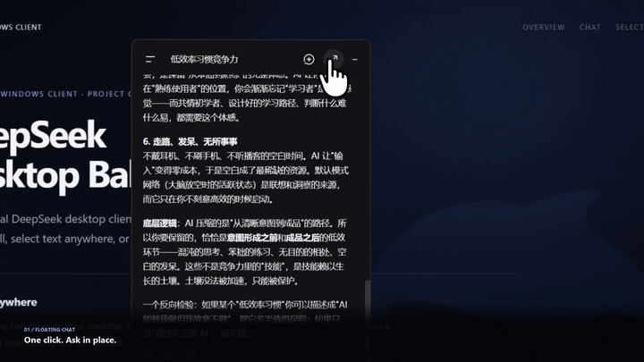

# DeepSeek 悬浮球（非官方）

[English](README.md) | 简体中文

一个面向 Windows 的 DeepSeek 桌面悬浮客户端，使用 Tauri 构建。聊天界面基于 [chat-demo](https://github.com/deepseek-ai/chat-demo)，悬浮球、窗口管理和桌面集成由本项目实现。

> 本项目为非官方项目，与 DeepSeek 官方无隶属、合作或背书关系。DeepSeek 品牌素材的权利归其权利人所有，详见 [TRADEMARKS.zh-CN.md](TRADEMARKS.zh-CN.md)。

## 演示



[观看更高清的 MP4 版本](https://lihaoyan25.github.io/deepseek-desktop-ball/demo-preview/deepseek-demo-final-optimized.mp4)

## 下载

前往 [Releases](https://github.com/lihaoyan25/deepseek-desktop-ball/releases/latest) 下载最新安装包：

- [DeepSeekBall_0.1.0_x64-setup.exe](https://github.com/lihaoyan25/deepseek-desktop-ball/releases/latest/download/DeepSeekBall_0.1.0_x64-setup.exe)
- [SHA256SUMS.txt](https://github.com/lihaoyan25/deepseek-desktop-ball/releases/latest/download/SHA256SUMS.txt)

无需安装 Node.js、Rust 或其他开发环境。系统要求为 Windows 10/11 x64，并需要 WebView2 Runtime。首次启动时，请在设置中填写自己的 DeepSeek API Key。

安装包未签名。如出现 Windows SmartScreen 提示，选择“仍要运行”。

### 常用操作

- `Ctrl + Shift + Space`：显示或隐藏面板。
- 点击悬浮球：恢复上次的迷你或放大模式。
- 拖动悬浮球：移动位置；靠近屏幕边缘时收起为尾巴。
- 迷你模式右上角：新对话、放大、收起。
- 放大模式右上角：恢复迷你模式、收起。两种模式都可拖动和调整大小。
- 拖动窗口边缘或角调整尺寸；双击标题栏在迷你/放大模式之间切换。尺寸和位置按模式记忆。
- 设置 → 通用设置 → 窗口尺寸 → 重置尺寸，可恢复默认窗口尺寸。
- 设置 → 通用设置 → 划词 AI 可开启全局划词工具栏；按 `Ctrl + Shift + A` 进行截图问答。

## 功能

- 悬浮球支持拖动、贴边收起和单实例运行。
- 可自由调整大小的迷你/放大窗口（最小 320×400），尺寸和位置按模式记忆。
- 小窗口使用紧凑排版：欢迎语、消息、输入框和操作按钮同步缩小。
- 划词 AI 工具栏支持解释、总结、翻译、复制和搜索；文字会自动进入紧凑对话，截图复用现有 DeepSeek 图片附件链路。
- Markdown、代码高亮、KaTeX 公式、思考过程、深度思考、智能搜索和来源引用。
- 侧栏会话搜索、全历史消息搜索、会话置顶和批量置顶/删除。
- 对话页右侧的轮次导航，支持问题/回复预览和点击跳转。
- 本地会话历史，支持消息分支、编辑、重新生成和导入导出。
- 文件拖放、语音输入、回复朗读、系统托盘和全局快捷键。
- 简体中文和英文界面、浅色和深色主题，以及柔和的界面过渡动画。

## 数据与存储

API Key 和设置保存在本机应用数据中，窗口尺寸和位置保存在同目录的 `panel-sizes.json`，会话和附件保存在本地浏览器存储中。本项目不提供后端服务，也不内嵌 DeepSeek 官方网页。发送消息、上传附件或使用语音功能时，相应内容会提交给所配置的 API 服务。本项目不收集遥测数据。

## 开发

需要 Node.js 24+、pnpm 11+、Rust stable（Windows GNU toolchain）、MSYS2 MinGW-w64、WebView2 Runtime，以及用于构建安装包的 NSIS。

```sh
cd app
pnpm install
pnpm tauri dev
```

开发服务器默认运行在 `http://localhost:8090`。

| 命令                            | 用途                |
| ------------------------------- | ------------------- |
| `pnpm tauri dev`                | 启动桌面开发环境    |
| `pnpm tauri build --no-bundle`  | 构建 release 产物   |
| `pnpm type`                     | TypeScript 类型检查 |
| `pnpm lint`                     | 使用 oxlint 检查    |
| `pnpm format`                   | 使用 oxfmt 格式化   |

构建产物：

```text
app/src-tauri/target/release/app.exe
app/src-tauri/target/release/WebView2Loader.dll
```

生成 Windows 安装包：

```sh
makensis installer/DeepSeek.nsi
```

输出为 `dist-installer/DeepSeekBall_0.1.0_x64-setup.exe`，安装包会同时安装许可证和中英双语的第三方/品牌声明。

项目结构：

```text
app/
  src/                       React 聊天界面、悬浮球和设置
  src-tauri/                 Tauri/Rust 窗口、托盘和安装配置
installer/DeepSeek.nsi        Windows 安装包脚本
demo-preview/                 演示 GIF、MP4 和 README 媒体文件
LICENSE                       项目 MIT 许可证
THIRD_PARTY_NOTICES.md        上游许可声明（英文）
THIRD_PARTY_NOTICES.zh-CN.md  上游许可声明（中文）
TRADEMARKS.md                 非官方声明与品牌素材说明（英文）
TRADEMARKS.zh-CN.md           非官方声明与品牌素材说明（中文）
```

## 已知限制

- 仅支持 Windows。
- 窗口尺寸和位置按主显示器恢复；离屏位置会被收回工作区。
- 不包含官方客户端的账号体系、官方同步或分享链接。
- 品牌相关界面用于识别所兼容的服务，不代表官方实现。

## 许可证

源代码和项目文档使用 [MIT](LICENSE) 许可证。上游 chat-demo 和 `@deepseek-ai/dsh-client-ui-primitives` 同样使用 MIT 许可证，完整版权与许可文本见 [THIRD_PARTY_NOTICES.zh-CN.md](THIRD_PARTY_NOTICES.zh-CN.md)。

DeepSeek 名称、logo、文字标志及相关品牌素材不属于 MIT 许可范围，详见 [TRADEMARKS.zh-CN.md](TRADEMARKS.zh-CN.md)。商业分发或大规模公开发布前，请自行确认品牌使用权限，或替换品牌素材。

## 致谢

- [DeepSeek chat-demo](https://github.com/deepseek-ai/chat-demo)：聊天界面和样式基础。
- [DeepSeek Harness](https://github.com/deepseek-ai/deepseek-harness)：部分官方 UI 图标与字标几何。
- [Tauri](https://tauri.app/)：桌面窗口和打包。
- React、rspack、KaTeX、Mermaid 及其他上游依赖的作者。
